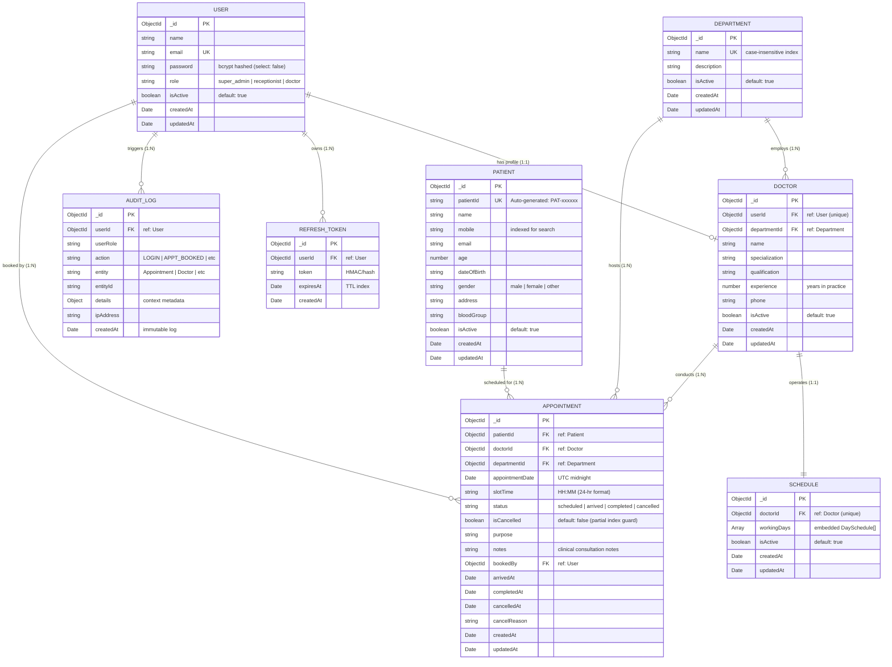
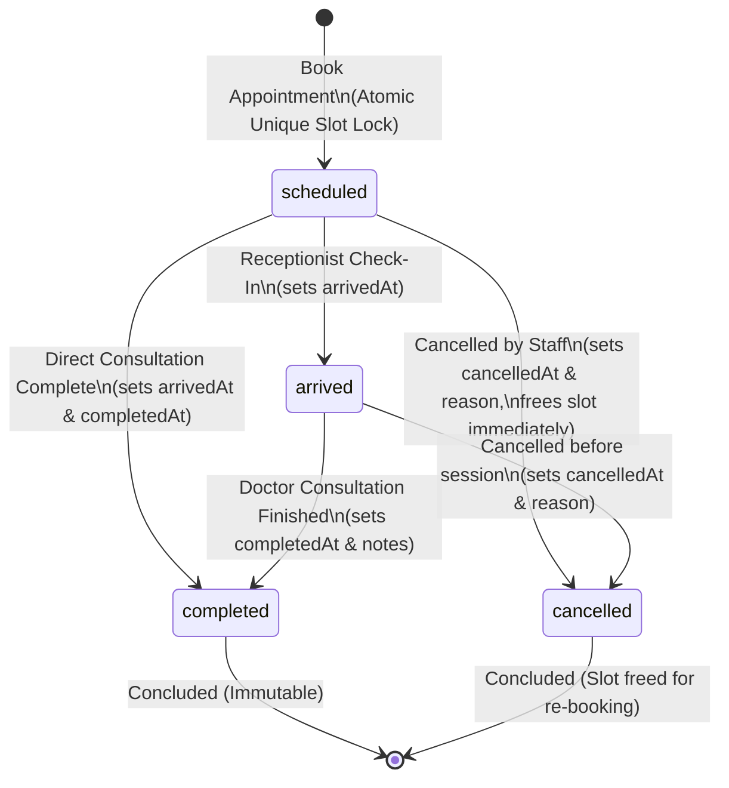

# Database Schema & Architecture

Enterprise Electronic Medical Record (EMR) Appointment Management System  
Database: **MongoDB (via Mongoose ODM)**

---

## 1. Entity Relationship (ER) Diagram

---

## 2. Collection Schemas & Field Definitions

### 2.1. `users` Collection
Stores authentication credentials and role assignments.

| Field | Type | Required | Constraints / Default | Description |
|---|---|---|---|---|
| `_id` | `ObjectId` | Yes | Primary Key | Unique user identifier. |
| `name` | `String` | Yes | Trimmed | User's full name. |
| `email` | `String` | Yes | Unique, Lowercase, Trimmed | Login identifier. |
| `password` | `String` | Yes | `select: false` | Bcrypt hashed with salt rounds `12`. |
| `role` | `String` | Yes | Enum: `super_admin`, `receptionist`, `doctor` | RBAC role. |
| `isActive` | `Boolean` | No | Default: `true` | Account active flag. |
| `createdAt` | `Date` | Auto | Managed by Mongoose | Timestamp of user creation. |
| `updatedAt` | `Date` | Auto | Managed by Mongoose | Timestamp of last modification. |

---

### 2.2. `departments` Collection
Clinical specialties (e.g., Cardiology, Orthopedics) used for departmental categorization and scheduling filters.

| Field | Type | Required | Constraints / Default | Description |
|---|---|---|---|---|
| `_id` | `ObjectId` | Yes | Primary Key | Department ID. |
| `name` | `String` | Yes | Unique (case-insensitive collation) | Department name. |
| `description`| `String` | No | Trimmed | Brief clinical scope description. |
| `isActive` | `Boolean` | No | Default: `true` | Active status flag. |
| `createdAt` | `Date` | Auto | Managed by Mongoose | Creation timestamp. |
| `updatedAt` | `Date` | Auto | Managed by Mongoose | Last update timestamp. |

---

### 2.3. `doctors` Collection
Clinical profiles linked to a `User` account for medical professionals.

| Field | Type | Required | Constraints / Default | Description |
|---|---|---|---|---|
| `_id` | `ObjectId` | Yes | Primary Key | Doctor profile identifier. |
| `userId` | `ObjectId` | Yes | Unique, ref: `User` | 1:1 foreign reference to user account. |
| `departmentId`| `ObjectId`| Yes | ref: `Department` | Department reference. |
| `name` | `String` | Yes | Trimmed | Doctor's professional title and name. |
| `specialization`| `String`| Yes | Trimmed | Primary medical specialty. |
| `qualification` | `String`| No | Trimmed | Medical degrees (e.g. MBBS, MD). |
| `experience` | `Number` | No | Positive integer | Years of active practice. |
| `phone` | `String` | No | Trimmed | Direct contact / extension number. |
| `isActive` | `Boolean` | No | Default: `true` | Active duty status. |
| `createdAt` | `Date` | Auto | Managed by Mongoose | Creation timestamp. |
| `updatedAt` | `Date` | Auto | Managed by Mongoose | Last update timestamp. |

---

### 2.4. `schedules` Collection
Configures weekly operational hours, multi-session timetables, break intervals, and consultation slot duration.

| Field | Type | Required | Constraints / Default | Description |
|---|---|---|---|---|
| `_id` | `ObjectId` | Yes | Primary Key | Schedule identifier. |
| `doctorId` | `ObjectId` | Yes | Unique, ref: `Doctor` | Doctor owning this timetable. |
| `workingDays` | `Array` | Yes | Array of `DaySchedule` | Embedded daily timetable configuration. |
| `isActive` | `Boolean` | No | Default: `true` | Master schedule toggle. |
| `createdAt` | `Date` | Auto | Managed by Mongoose | Creation timestamp. |
| `updatedAt` | `Date` | Auto | Managed by Mongoose | Last update timestamp. |

#### Embedded `DaySchedule` Object:
- `day` (`String`, enum: `monday` through `sunday`)
- `sessions` (`Array` of `{ start: "HH:MM", end: "HH:MM", label?: string }`)
- `breaks` (`Array` of `{ start: "HH:MM", end: "HH:MM" }`)
- `slotDurationMinutes` (`Number`, min: `5`)

---

### 2.5. `patients` Collection
Central demographic registry with human-readable identification.

| Field | Type | Required | Constraints / Default | Description |
|---|---|---|---|---|
| `_id` | `ObjectId` | Yes | Primary Key | MongoDB identifier. |
| `patientId` | `String` | Yes | Unique, Pattern: `PAT-xxxxxx` | Human-readable patient ID. |
| `name` | `String` | Yes | Trimmed | Patient full name. |
| `mobile` | `String` | Yes | Regex: `^\d{10,15}$` | Contact mobile number. |
| `email` | `String` | No | Valid email format | Optional email address. |
| `age` | `Number` | No | Positive integer | Patient age in years. |
| `dateOfBirth`| `String` | No | `YYYY-MM-DD` | Date of birth. |
| `gender` | `String` | No | Enum: `male`, `female`, `other` | Gender identity. |
| `address` | `String` | No | Trimmed | Residential address. |
| `bloodGroup` | `String` | No | Enum: `A+`, `O+`, etc. | Blood group code. |
| `isActive` | `Boolean` | No | Default: `true` | Registry status. |
| `createdAt` | `Date` | Auto | Managed by Mongoose | Registration timestamp. |
| `updatedAt` | `Date` | Auto | Managed by Mongoose | Last update timestamp. |

---

### 2.6. `appointments` Collection
Transactional record tracking consultations, lifecycle states, and concurrency guards.

| Field | Type | Required | Constraints / Default | Description |
|---|---|---|---|---|
| `_id` | `ObjectId` | Yes | Primary Key | Appointment ID. |
| `patientId` | `ObjectId` | Yes | ref: `Patient`, Indexed | Patient receiving consultation. |
| `doctorId` | `ObjectId` | Yes | ref: `Doctor`, Indexed | Doctor assigned to appointment. |
| `departmentId`| `ObjectId`| Yes | ref: `Department` | Department hosting appointment. |
| `appointmentDate`| `Date` | Yes | UTC Midnight (00:00:00.000Z) | Calendar date of consultation. |
| `slotTime` | `String` | Yes | Format: `HH:MM` | Slot start time (24-hour). |
| `status` | `String` | Yes | Enum: `scheduled`, `arrived`, `completed`, `cancelled` (default: `scheduled`) | Lifecycle status. |
| `isCancelled` | `Boolean` | Yes | Default: `false`, Indexed | Flag utilized in partial unique index. |
| `purpose` | `String` | No | Trimmed | Reason for consultation. |
| `notes` | `String` | No | Trimmed | Doctor consultation diagnosis/notes. |
| `bookedBy` | `ObjectId` | Yes | ref: `User` | Staff member who initiated booking. |
| `arrivedAt` | `Date` | No | Timestamp | Patient check-in arrival time. |
| `completedAt` | `Date` | No | Timestamp | Doctor consultation completion time. |
| `cancelledAt` | `Date` | No | Timestamp | Cancellation timestamp. |
| `cancelReason`| `String` | No | Trimmed | Mandatory cancellation reason. |
| `createdAt` | `Date` | Auto | Managed by Mongoose | Booking creation timestamp. |
| `updatedAt` | `Date` | Auto | Managed by Mongoose | Last modification timestamp. |

---

### 2.7. `audit_logs` Collection
Append-only legal and regulatory compliance trail.

| Field | Type | Required | Constraints / Default | Description |
|---|---|---|---|---|
| `_id` | `ObjectId` | Yes | Primary Key | Log identifier. |
| `userId` | `ObjectId` | Yes | ref: `User` | User who performed the action. |
| `userRole` | `String` | Yes | Enum: `super_admin`, `receptionist`, `doctor` | User role at action time. |
| `action` | `String` | Yes | e.g. `LOGIN`, `APPOINTMENT_BOOKED` | Action verb. |
| `entity` | `String` | Yes | e.g. `Appointment`, `Doctor` | Target entity. |
| `entityId` | `String` | No | ID string | ID of affected document. |
| `details` | `Object` | No | Mixed object | Diff, payload, or context metadata. |
| `ipAddress` | `String` | No | IPv4/IPv6 | Originating client IP. |
| `createdAt` | `Date` | Auto | Managed by Mongoose | Timestamp of action. |

---

### 2.8. `refresh_tokens` Collection
Stores rotating refresh tokens for JWT renewal.

| Field | Type | Required | Constraints / Default | Description |
|---|---|---|---|---|
| `_id` | `ObjectId` | Yes | Primary Key | Token identifier. |
| `userId` | `ObjectId` | Yes | ref: `User` | User owning the session. |
| `token` | `String` | Yes | Hashed token string | Refresh token hash. |
| `expiresAt` | `Date` | Yes | TTL Index (`expireAfterSeconds: 0`) | Automatic purge upon expiry. |
| `createdAt` | `Date` | Auto | Managed by Mongoose | Creation timestamp. |

---

## 3. Database Indexes & Performance Optimizations

| Collection | Index Fields | Type / Options | Purpose |
|---|---|---|---|
| `appointments` | `{ doctorId: 1, appointmentDate: 1, slotTime: 1 }` | **Unique**, `partialFilterExpression: { isCancelled: false }` | **Zero-collision double booking guard**. Prevents concurrent duplicate slot bookings for the same doctor on the same day. |
| `appointments` | `{ appointmentDate: 1, doctorId: 1, status: 1 }` | Compound Index | Accelerates daily queue lookups and doctor timetable queries. |
| `appointments` | `{ patientId: 1 }` | Single Field Index | Optimizes patient appointment history queries. |
| `patients` | `{ patientId: 1 }` | Unique Index | Enforces uniqueness of `PAT-xxxxxx` IDs. |
| `patients` | `{ mobile: 1 }` | Single Field Index | Fast phone number lookup at reception. |
| `patients` | `{ name: "text" }` | Text Index | Full-text fuzzy search for patient names. |
| `departments` | `{ name: 1 }` | Unique Index (`collation: { locale: 'en', strength: 2 }`) | Case-insensitive department name uniqueness. |
| `doctors` | `{ userId: 1 }` | Unique Index | Enforces 1:1 user-to-doctor relationship. |
| `schedules` | `{ doctorId: 1 }` | Unique Index | Enforces single timetable configuration per doctor. |
| `refresh_tokens`| `{ expiresAt: 1 }` | TTL Index (`expireAfterSeconds: 0`) | MongoDB background engine automatically purges expired session tokens. |

---

## 4. Appointment Lifecycle State Machine

### State Transition Rules:
- **`scheduled` $\rightarrow$ `arrived`**: Executed by Receptionist or Admin when patient arrives at clinic waiting room.
- **`arrived` $\rightarrow$ `completed`**: Executed by Doctor upon completing clinical consultation and recording notes.
- **`scheduled` $\rightarrow$ `completed`**: Doctor calls patient directly into consultation room without waiting for reception arrival check-in. System automatically timestamps both `arrivedAt` and `completedAt`.
- **`scheduled`/`arrived` $\rightarrow$ `cancelled`**: Soft-deletes record, sets `isCancelled: true`, timestamps cancellation, and immediately frees the time slot for other patients.
- **`completed` or `cancelled`**: Final states. Once completed or cancelled, appointments cannot be altered or re-completed.
